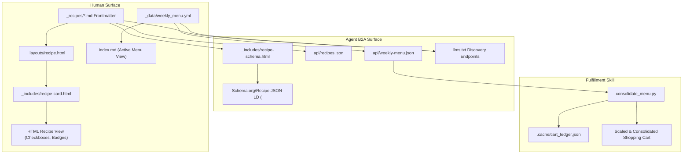

# Dual-Surface Recipe & Weekly Meal Planning Blog Implementation Plan

> **For agentic workers:** REQUIRED SUB-SKILL: Use `superpowers:subagent-driven-development` to implement this plan task-by-task. Steps use checkbox (`- [ ]`) syntax for tracking.

**Goal:** Transform `hawzy.github.io` into a dual-surface Minimal Mistakes Jekyll recipe and weekly meal-planning blog that serves human readers via responsive UI cards and AI agents via machine endpoints (`/llms.txt`, `/api/weekly-menu.json`, `/api/recipes.json`, `Schema.org/Recipe` JSON-LD), paired with a local Antigravity grocery consolidation skill verified end-to-end against a local Jekyll server.

**Architecture:** A Jekyll 4 collection (`_recipes`) configured with strictly typed YAML frontmatter renders both human-facing interactive recipe cards and Schema.org linked data via Liquid templates. Liquid endpoint templates compile static, cache-friendly JSON feeds and `llms.txt` at build time. A standalone Python stdlib consolidation engine in `.agents/skills/weekly-grocery-order/` queries the local API, scales ingredient quantities across the weekly menu, filters pantry staples, aggregates identical items, and maintains an idempotency ledger.

**Architecture Diagram:**



**Tech Stack:** Jekyll 4.3, Ruby 3.x / Bundler, Minimal Mistakes (`mmistakes/minimal-mistakes`), Liquid, Python 3.12 (stdlib only), Lunr.js search, Schema.org JSON-LD.

---

## Global Constraints & Safety Invariants

1. **NO REMOTE GIT PUSH:** Under no circumstances should `git push` be executed. All changes, branch creation, staging, and commits remain strictly local on `feat/agentic-recipe-blog`.
2. **GitHub Pages Hygiene:** Local agent scaffolding, Python virtual environments, and caches MUST NOT compile into `_site/`. The following entries must be present in `_config.yml`'s `exclude:` array:
   `.agents/`, `.agent/`, `agent/`, `.venv/`, `.cache/`, `AGENTS.md`, `Gemfile`, `Gemfile.lock`, `README.md`.
3. **Zero Unstructured Ingredients:** Quantitative recipe data (amounts, units, categories, retailer query, UPC) MUST reside in YAML frontmatter. `_recipes/*.md` bodies contain only narrative/editorial notes; ingredients and procedural steps render strictly via Liquid loops.
4. **Preservation of Existing Content:** All existing blog posts under `_posts/`, assets, and configurations must be preserved.

---

## Task 1: Environment & Dependency Setup

**Files:**
- Modify: `Gemfile`
- Create: `_config.yml` (backup original to `_config.yml.bak`)
- Modify: `.gitignore`

**Interfaces:**
- Consumes: System package manager (`winget` or `choco`) for Ruby 3.3 DevKit.
- Produces: Working `ruby`, `bundle`, and `jekyll` executables capable of building the site.

- [ ] **Step 1: Check and install Ruby & Bundler**
  Verify Ruby availability. If absent, install Ruby with DevKit via `winget` into the user environment:
  ```powershell
  winget install --id RubyInstallerTeam.RubyWithDevKit.3.3 --silent --accept-package-agreements --accept-source-agreements --scope user
  ```
  Refresh the environment PATH and verify:
  ```powershell
  ruby -v
  bundle -v
  ```

- [ ] **Step 2: Update Gemfile for Minimal Mistakes and Jekyll 4**
  Update `Gemfile`:
  ```ruby
  source "https://rubygems.org"

  gem "jekyll", "~> 4.3"
  gem "minimal-mistakes-jekyll", "~> 4.28"
  gem "jekyll-include-cache"
  gem "jekyll-feed"
  gem "jekyll-seo-tag"
  gem "jekyll-sitemap"
  gem "webrick"
  ```

- [ ] **Step 3: Update .gitignore**
  Ensure `.cache/`, `.venv/`, `_site/`, `.jekyll-cache/`, and `.jekyll-metadata` are ignored in `.gitignore`.

- [ ] **Step 4: Install Bundler dependencies**
  Run:
  ```powershell
  bundle install
  ```
  Expected: Bundler resolves and installs all required gems.

- [ ] **Step 5: Commit environment baseline**
  ```powershell
  git add Gemfile Gemfile.lock .gitignore
  git commit -m "chore: configure Jekyll 4 and Minimal Mistakes dependencies"
  ```

---

## Task 2: Minimal Mistakes Configuration & Navigation Setup

**Files:**
- Modify: `_config.yml`
- Create: `_data/navigation.yml`
- Create: `_data/ui-text.yml`
- Create: `recipes/index.md`
- Create: `search.md`

**Interfaces:**
- Consumes: Minimal Mistakes theme gem and collection mechanics.
- Produces: Configured `recipes` collection, masthead navigation, dirt skin, build exclusion list.

- [ ] **Step 1: Configure _config.yml**
  Back up existing `_config.yml` to `_config.yml.bak` and update `_config.yml` with:
  ```yaml
  title: "Hawzy's Kitchen & Code"
  title_separator: "-"
  subtitle: "Family recipes, weekly meal planning, and automated kitchen ops"
  name: "Hawzy"
  description: "Family recipe catalog, weekly dinner plans, and agentic kitchen fulfillment"
  url: "https://hawzy.github.io"
  baseurl: ""
  repository: "hawzy/hawzy.github.io"

  # Theme settings
  remote_theme: "mmistakes/minimal-mistakes@4.28.1"
  minimal_mistakes_skin: "dirt"

  # Search
  search: true
  search_full_content: true
  search_provider: lunr

  # Collections
  collections:
    recipes:
      output: true
      permalink: /:collection/:path/

  # Defaults
  defaults:
    - scope:
        path: ""
        type: "posts"
      values:
        layout: single
        author_profile: true
        read_time: true
        comments: true
        share: true
        related: true
    - scope:
        path: ""
        type: "recipes"
      values:
        layout: recipe
        author_profile: false
        read_time: false
        comments: false
        share: false
        classes: wide

  # Plugins
  plugins:
    - jekyll-include-cache
    - jekyll-feed
    - jekyll-seo-tag
    - jekyll-sitemap

  # Include & Exclude
  include:
    - llms.txt

  exclude:
    - .agents/
    - .agent/
    - agent/
    - .venv/
    - .cache/
    - AGENTS.md
    - Gemfile
    - Gemfile.lock
    - README.md
    - vendor/
    - _config.yml.bak
  ```

- [ ] **Step 2: Create _data/navigation.yml**
  Configure the masthead navigation in `_data/navigation.yml`:
  ```yaml
  main:
    - title: "Weekly Menu"
      url: /
    - title: "All Recipes"
      url: /recipes/
    - title: "Search"
      url: /search/
    - title: "Agent API"
      url: /api/weekly-menu.json
  ```

- [ ] **Step 3: Create _data/ui-text.yml**
  Create `_data/ui-text.yml` providing standard English labels to prevent `jekyll-data` missing string warnings.

- [ ] **Step 4: Create recipes/index.md and search.md**
  - Create `recipes/index.md`:
    ```markdown
    ---
    layout: archive
    title: "All Recipes"
    permalink: /recipes/
    author_profile: false
    classes: wide
    ---

    
      
    
    ```
  - Create `search.md` with `layout: search` and `permalink: /search/`.

- [ ] **Step 5: Verify Jekyll builds without errors**
  Run: `bundle exec jekyll build`
  Expected: Clean build with exit code 0.

- [ ] **Step 6: Commit**
  ```powershell
  git add _config.yml _data/navigation.yml _data/ui-text.yml recipes/index.md search.md
  git commit -m "feat: configure recipes collection, dirt skin, and navigation"
  ```

---

## Task 3: Dual-Surface Recipe Templates & Schema.org JSON-LD

**Files:**
- Create: `_includes/recipe-card.html`
- Create: `_includes/recipe-schema.html`
- Create: `_layouts/recipe.html`

**Interfaces:**
- Consumes: Frontmatter variables on `page`: `prep_minutes`, `cook_minutes`, `servings`, `calories_per_serving`, `cuisine`, `ingredients`, `instructions`.
- Produces: Interactive visual recipe card and valid Schema.org/Recipe JSON-LD script tag.

- [ ] **Step 1: Create _includes/recipe-card.html**
  ```html
  <div class="recipe-card-container">
    <div class="recipe-meta-bar" style="display: flex; gap: 1.5rem; background: rgba(120, 90, 60, 0.1); padding: 1rem 1.25rem; border-radius: 8px; margin-bottom: 2rem; flex-wrap: wrap;">
      <div><strong>Prep:</strong> {{ page.prep_minutes }} mins</div>
      <div><strong>Cook:</strong> {{ page.cook_minutes }} mins</div>
      <div><strong>Total:</strong> {{ page.prep_minutes | plus: page.cook_minutes }} mins</div>
      <div><strong>Yield:</strong> {{ page.servings }} servings</div>
      <div><strong>Calories:</strong> {{ page.calories_per_serving }} kcal / serving</div>
      <div><strong>Cuisine:</strong> {{ page.cuisine }}</div>
    </div>

    <div class="recipe-body-grid" style="display: grid; grid-template-columns: minmax(280px, 1fr) 2fr; gap: 2.5rem;">
      <div class="recipe-ingredients-section">
        <h3>Ingredients</h3>
        <ul class="recipe-ingredients-list" style="list-style: none; padding-left: 0;">
          
            <li style="margin-bottom: 0.75rem; display: flex; align-items: baseline; gap: 0.5rem;">
              <input type="checkbox" id="ing-{{ forloop.index }}" style="margin-top: 0.25rem;">
              <label for="ing-{{ forloop.index }}">
                {{ ing.display_text }}
                
                  <span class="badge" style="font-size: 0.75rem; background: #e0e0e0; color: #555; padding: 2px 6px; border-radius: 4px; margin-left: 0.25rem;">Pantry</span>
                
              </label>
            </li>
          
        </ul>
      </div>

      <div class="recipe-instructions-section">
        <h3>Instructions</h3>
        <ol class="recipe-instructions-list" style="padding-left: 1.5rem; line-height: 1.6;">
          
            <li style="margin-bottom: 1rem;">{{ step }}</li>
          
        </ol>
      </div>
    </div>
  </div>
  ```

- [ ] **Step 2: Create _includes/recipe-schema.html**
  ```html
  
  <script type="application/ld+json">
  {
    "@context": "https://schema.org",
    "@type": "Recipe",
    "@id": {{ page.url | absolute_url | jsonify }},
    "name": {{ page.title | jsonify }},
    "description": {{ page.excerpt | strip_newlines | strip | jsonify }},
    "datePublished": {{ page.date | date_to_xmlschema | jsonify }},
    "prepTime": {{ page.prep_time_iso | jsonify }},
    "cookTime": {{ page.cook_time_iso | jsonify }},
    "totalTime": {{ page.total_time_iso | jsonify }},
    "recipeYield": {{ page.servings | append: " servings" | jsonify }},
    "recipeCategory": {{ page.categories | first | jsonify }},
    "recipeCuisine": {{ page.cuisine | jsonify }},
    "keywords": {{ page.tags | join: ", " | jsonify }},
    "nutrition": {
      "@type": "NutritionInformation",
      "calories": {{ page.calories_per_serving | append: " calories" | jsonify }}
    },
    "recipeIngredient": [
      
        {{ ing.display_text | jsonify }},
      
    ],
    "recipeInstructions": [
      
        {
          "@type": "HowToStep",
          "position": {{ forloop.index }},
          "text": {{ step | jsonify }}
        },
      
    ]
  }
  </script>
  
  ```

- [ ] **Step 3: Create _layouts/recipe.html**
  Inherits from Minimal Mistakes `single` layout, embeds `recipe-schema.html` and renders `recipe-card.html`:
  ```html
  ---
  layout: single
  ---

  

  {{ content }}

  
  ```

- [ ] **Step 4: Commit**
  ```powershell
  git add _includes/recipe-card.html _includes/recipe-schema.html _layouts/recipe.html
  git commit -m "feat: add dual-surface recipe layout, card include, and Schema.org JSON-LD"
  ```

---

## Task 4: Seed Recipe Catalog & Weekly Menu State

**Files:**
- Create: `_recipes/overnight-dry-brined-ribeye.md`
- Create: `_recipes/citrus-chile-glazed-salmon.md`
- Create: `_recipes/homemade-ramen-kewpie-slaw.md`
- Create: `_data/weekly_menu.yml`
- Modify: `index.md`

**Interfaces:**
- Consumes: Recipe YAML schema with shared non-pantry ingredients (`fresh garlic bulb`, `limes`).
- Produces: Populated `site.recipes`, active weekly menu data, homepage view.

- [ ] **Step 1: Author Seed Recipe 1 - Overnight Dry-Brined Ribeye**
  Create `_recipes/overnight-dry-brined-ribeye.md` with full metadata, ISO 8601 durations (`PT15M`, `PT10M`, `PT25M`), structured ingredients (kosher salt, ribeye steak, butter, garlic cloves, fresh rosemary), and step-by-step instructions.

- [ ] **Step 2: Author Seed Recipe 2 - Citrus-Chile Glazed Salmon**
  Create `_recipes/citrus-chile-glazed-salmon.md` with shared ingredients (garlic cloves, limes) with identical `item` and `unit` values for cross-recipe math aggregation.

- [ ] **Step 3: Author Seed Recipe 3 - Weeknight Shoyu Ramen with Kewpie Slaw**
  Create `_recipes/homemade-ramen-kewpie-slaw.md` with ramen noodles, chicken broth, soy sauce, eggs, cabbage, Kewpie mayo, scallions, and garlic cloves.

- [ ] **Step 4: Create _data/weekly_menu.yml**
  ```yaml
  week_of: "2026-10-25"
  default_modality: "PICKUP"
  postal_code: "99223"
  preferred_retailer_key: "fred-meyer"
  meals:
    - day: "Monday"
      recipe_slug: "overnight-dry-brined-ribeye"
      scale_factor: 1.0
      notes: "Family dinner kick-off"
    - day: "Wednesday"
      recipe_slug: "citrus-chile-glazed-salmon"
      scale_factor: 1.5
      notes: "Extra portions for lunch prep"
    - day: "Friday"
      recipe_slug: "homemade-ramen-kewpie-slaw"
      scale_factor: 1.0
      notes: "Fun Friday family dinner"
  ```

- [ ] **Step 5: Update Homepage (index.md)**
  Modify `index.md` to feature the **Active Weekly Dinner Plan** (looping through `site.data.weekly_menu.meals` to match `site.recipes` by slug, showing meal day, title, and scale factor), followed by a grid of latest recipes.

- [ ] **Step 6: Run build and verify schema generation**
  Run: `bundle exec jekyll build`
  Check that `_site/recipes/overnight-dry-brined-ribeye/index.html` contains valid `<script type="application/ld+json">`.

- [ ] **Step 7: Commit**
  ```powershell
  git add _recipes/ _data/weekly_menu.yml index.md
  git commit -m "feat: add 3 seed recipes with structured frontmatter and weekly menu state"
  ```

---

## Task 5: Static B2A Endpoints (/llms.txt & JSON APIs)

**Files:**
- Create: `llms.txt`
- Create: `api/weekly-menu.json`
- Create: `api/recipes.json`

**Interfaces:**
- Consumes: `site.recipes` and `site.data.weekly_menu`.
- Produces: Static machine endpoints compiled into `_site/`.

- [ ] **Step 1: Create llms.txt**
  ```markdown
  ---
  layout: null
  permalink: /llms.txt
  ---
  # Hawzy's Kitchen & Recipe Blog

  > An agentic family recipe catalog, weekly dinner planning engine, and grocery fulfillment platform.

  ## Machine Endpoints
  - [Active Weekly Menu JSON]({{ '/api/weekly-menu.json' | absolute_url }}): Scaled weekly menu, scheduled meals, and ingredient manifests.
  - [All Recipes JSON]({{ '/api/recipes.json' | absolute_url }}): Complete catalog of structured recipe objects.

  ## Recipes
  
  - [{{ recipe.title }}]({{ recipe.url | absolute_url }}): {{ recipe.excerpt | strip_newlines | strip }} ({{ recipe.cuisine }}, {{ recipe.prep_minutes | plus: recipe.cook_minutes }} mins)
  
  ```

- [ ] **Step 2: Create api/recipes.json**
  ```liquid
  ---
  layout: null
  permalink: /api/recipes.json
  ---
  [
    
    {
      "id": {{ recipe.id | jsonify }},
      "slug": {{ recipe.slug | jsonify }},
      "title": {{ recipe.title | jsonify }},
      "url": {{ recipe.url | absolute_url | jsonify }},
      "excerpt": {{ recipe.excerpt | strip_newlines | strip | jsonify }},
      "date": {{ recipe.date | date_to_xmlschema | jsonify }},
      "prep_minutes": {{ recipe.prep_minutes | default: 0 }},
      "cook_minutes": {{ recipe.cook_minutes | default: 0 }},
      "servings": {{ recipe.servings | default: 1 }},
      "calories_per_serving": {{ recipe.calories_per_serving | default: 0 }},
      "cuisine": {{ recipe.cuisine | jsonify }},
      "categories": {{ recipe.categories | jsonify }},
      "tags": {{ recipe.tags | jsonify }},
      "ingredients": {{ recipe.ingredients | jsonify }},
      "instructions": {{ recipe.instructions | jsonify }}
    },
    
  ]
  ```

- [ ] **Step 3: Create api/weekly-menu.json**
  Resolves `site.data.weekly_menu.meals` against `site.recipes`:
  ```liquid
  ---
  layout: null
  permalink: /api/weekly-menu.json
  ---
  {
    "week_of": {{ site.data.weekly_menu.week_of | jsonify }},
    "default_modality": {{ site.data.weekly_menu.default_modality | jsonify }},
    "postal_code": {{ site.data.weekly_menu.postal_code | jsonify }},
    "preferred_retailer_key": {{ site.data.weekly_menu.preferred_retailer_key | jsonify }},
    "meals": [
      
        
        
          
            
          
        
        {
          "day": {{ meal.day | jsonify }},
          "recipe_slug": {{ meal.recipe_slug | jsonify }},
          "scale_factor": {{ meal.scale_factor }},
          "notes": {{ meal.notes | jsonify }},
          "recipe_title": {{ matched_recipe.title | jsonify }},
          "recipe_url": {{ matched_recipe.url | absolute_url | jsonify }},
          "ingredients": {{ matched_recipe.ingredients | jsonify }}
        },
      
    ]
  }
  ```

- [ ] **Step 4: Verify build and JSON validation**
  Run: `bundle exec jekyll build`
  Test JSON validity with Python:
  ```powershell
  python -c "import json; json.load(open('_site/api/recipes.json')); json.load(open('_site/api/weekly-menu.json')); print('JSON valid!')"
  ```
  Expected: "JSON valid!"

- [ ] **Step 5: Commit**
  ```powershell
  git add llms.txt api/
  git commit -m "feat: add /llms.txt, /api/weekly-menu.json, and /api/recipes.json endpoints"
  ```

---

## Task 6: Antigravity Grocery Fulfillment Skill & Consolidation Engine

**Files:**
- Create: `AGENTS.md`
- Create: `.agents/skills/weekly-grocery-order/SKILL.md`
- Create: `.agents/skills/weekly-grocery-order/scripts/consolidate_menu.py`
- Create: `tests/test_consolidation.py`

**Interfaces:**
- Consumes: JSON payload from `http://127.0.0.1:4000/api/weekly-menu.json` or local mock.
- Produces: Aggregated shopping cart, idempotency records in `.cache/cart_ledger.json`.

- [ ] **Step 1: Write Unit Test for Consolidation Engine**
  Create `tests/test_consolidation.py` testing scaling, pantry staple skipping, and ingredient summation across meals.
  Run test: `python -m unittest tests/test_consolidation.py`
  Expected: FAIL (module not yet created).

- [ ] **Step 2: Implement .agents/skills/weekly-grocery-order/scripts/consolidate_menu.py**
  Implement the stdlib-only Python consolidation script:
  - Fetches from `--url` (or local file for testing).
  - Multiplies `quantity` by `scale_factor`.
  - Splits items where `pantry_staple == True` into a skipped list.
  - Aggregates non-pantry items by `(item.lower(), unit.lower())`.
  - Manages `.cache/cart_ledger.json` keyed by `week_of`.
  - Prints both structured JSON and a formatted console table.

- [ ] **Step 3: Run unit tests to verify implementation**
  Run: `python -m unittest tests/test_consolidation.py`
  Expected: PASS.

- [ ] **Step 4: Create AGENTS.md**
  Write `AGENTS.md` at repository root detailing:
  - Repository overview and dual-surface philosophy.
  - How to add new recipes to `_recipes/` with correct YAML frontmatter.
  - How to update `_data/weekly_menu.yml`.
  - How to invoke the grocery consolidation skill.

- [ ] **Step 5: Create .agents/skills/weekly-grocery-order/SKILL.md**
  Write the skill manifest with YAML frontmatter (`name: weekly-grocery-order`, `description: ...`) and workflow instructions.

- [ ] **Step 6: Commit**
  ```powershell
  git add AGENTS.md .agents/ tests/
  git commit -m "feat: add AGENTS.md and weekly-grocery-order Antigravity skill"
  ```

---

## Task 7: Full End-to-End Verification & Safety Audit

**Files:**
- Target verification across all generated outputs in `_site/` and live local server.

- [ ] **Step 1: Clean build check & hygiene verification**
  Run:
  ```powershell
  bundle exec jekyll build
  ```
  Verify exit code `0`.
  Verify `Test-Path _site/.agents` returns `False`.

- [ ] **Step 2: Start local Jekyll server in background**
  Launch `bundle exec jekyll serve --port 4000` as a background process or task.
  Verify HTTP response:
  ```powershell
  curl -s -o /dev/null -w "%{http_code}" http://127.0.0.1:4000/
  ```
  Expected: `200`.

- [ ] **Step 3: Validate API endpoints**
  Verify `/api/weekly-menu.json` and `/api/recipes.json` parse cleanly:
  ```powershell
  curl -s http://127.0.0.1:4000/api/weekly-menu.json | python -m json.tool > $null
  curl -s http://127.0.0.1:4000/api/recipes.json | python -m json.tool > $null
  ```

- [ ] **Step 4: Validate /llms.txt**
  Verify `http://127.0.0.1:4000/llms.txt` starts with `# `, includes `> `, and references all 3 recipes and API endpoints.

- [ ] **Step 5: Validate Schema.org JSON-LD linked data**
  Run a Python validation script against `_site/recipes/overnight-dry-brined-ribeye/index.html` extracting the `<script type="application/ld+json">` tag and verifying with `json.loads()`.

- [ ] **Step 6: Run consolidation dry-run against running server**
  ```powershell
  python .agents/skills/weekly-grocery-order/scripts/consolidate_menu.py --url http://127.0.0.1:4000/api/weekly-menu.json --dry-run
  ```
  Verify that shared ingredients (e.g. garlic, limes) are scaled and summed correctly and pantry items are excluded from active cart.

- [ ] **Step 7: Git safety check**
  Run:
  ```powershell
  git status
  git log -n 5 --oneline
  ```
  Confirm all changes are committed locally to `feat/agentic-recipe-blog` and zero pushes to remote.

---

## User Review Required

> [!IMPORTANT]
> **Ruby Environment Provisioning**: Since Ruby is not currently on your Windows system PATH, Task 1 will install Ruby 3.3 DevKit via `winget` in user scope so `bundle` and `jekyll` can run locally.

> [!NOTE]
> **Idempotency Ledger**: The grocery fulfillment engine will write idempotency markers to `.cache/cart_ledger.json`. This directory is explicitly ignored by git and excluded from Jekyll builds to guarantee zero leakage into the static site.
